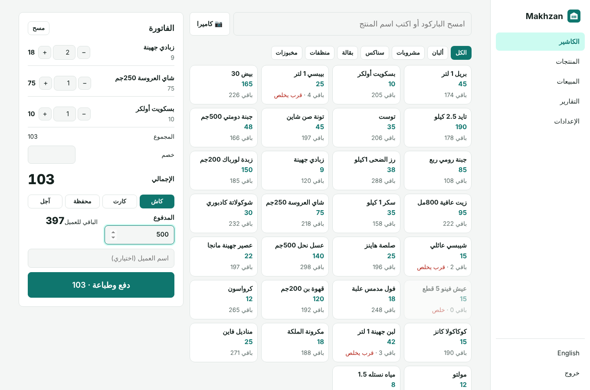
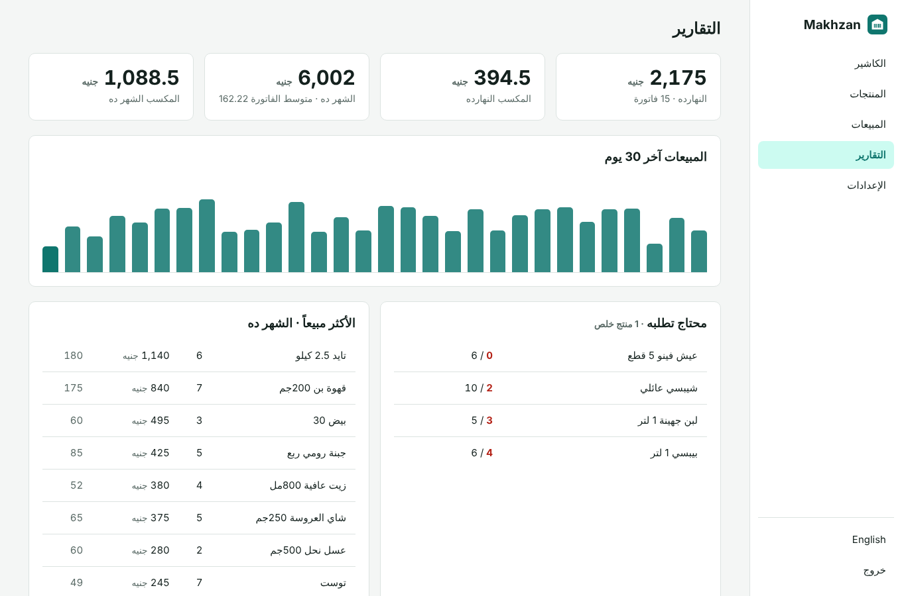
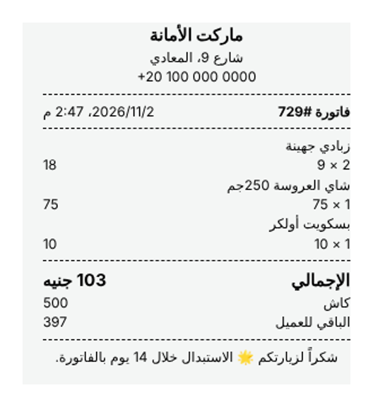
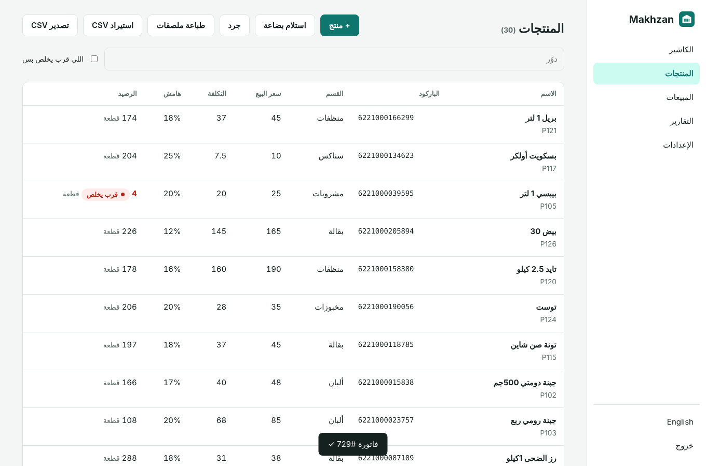
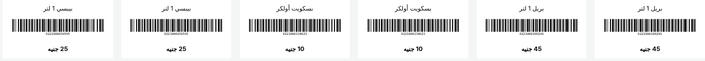

<div align="center">

# Makhzan · مخزن

**Point of sale and inventory for shops and minimarkets.**
Scan barcodes with a USB scanner or the phone camera, take cash, card or wallet payments, print receipts, and watch stock update by itself. Receive goods from suppliers, count the shelves, get warned before things run out, print barcode labels, and see your real profit. Self-hosted, no monthly fee, no dependencies.

[](https://www.hostinger.com/docker-hosting?compose_url=https://raw.githubusercontent.com/mashraf1997/makhzan/main/docker-compose.yml&REFERRALCODE=YOUR_REFERRAL_CODE)

[English](#what-it-does) · [العربية](#بالعربي)



</div>

---

## What it does

**Checkout**
- Scan with any USB or Bluetooth barcode scanner (it types into the search box), or with the phone or tablet camera in browsers that support it (Chrome on Android, Edge).
- Or tap products by category. Quantities, discount, cash with change, card, wallet or on credit.
- 80 mm thermal receipt printed straight away; reprint any sale later.
- Selling more than you have is blocked (or allowed, if you prefer).

**Stock**
- Products with barcode, code, category, unit, price, cost and a reorder level.
- **Receive goods** from a supplier: stock goes up and the average cost is updated.
- **Stock count:** type what is really on the shelf and the difference is recorded.
- Full history for every product: sales, purchases, counts, returns and online orders.
- **Barcode labels** (Code 128) with the name and price, on any printer.
- **Import from Excel / CSV** with Arabic or English column names, and export back.

**Reports (owner only)**
- Sales and profit today and this month, average sale, sales per day and per hour, best sellers with their profit, sales by category and payment method.
- What to reorder, what has sold out, and the value of your stock at cost and at retail.
- Returns put items back in stock and are left out of the totals.

**More**
- **Cashier PIN:** cashiers sell, receive goods and count, but cannot see costs or reports, change prices or make returns.
- Prices with tax included or tax added on top.
- **Connections:** every sale can go to [Raseed](https://github.com/mashraf1997/raseed), the cash book, and orders from [Dukkan](https://github.com/mashraf1997/dukkan) or [Wakeel](https://github.com/mashraf1997/wakeel) take items out of stock.
- Arabic and English, right-to-left ready, Arabic digits accepted everywhere.

<p align="center">
  
  
</p>
<p align="center"></p>
<p align="center"></p>

## Deploy

**One click:** press **Deploy on Hostinger** above, open `http://YOUR-SERVER-IP` and create your password. Use a domain with HTTPS: browsers only allow the camera on HTTPS pages.

**Docker:**

```bash
git clone https://github.com/mashraf1997/makhzan.git && cd makhzan
docker compose up -d
```

**Node.js 20+:** `npm start` (no packages to install)

| Variable | Default | Purpose |
|---|---|---|
| `PORT` | `3000` | HTTP port |
| `DATA_DIR` | `./data` | Where `makhzan.json` is stored. Back it up. |
| `SETUP_TOKEN` | *(empty)* | Required to create the first admin when set |
| `DEMO_MODE` | `false` | `true` makes this a public demo: sample data, a reset every hour, and the password, PIN and webhook locked |
| `DEMO_PASSWORD` | `demo1234` | Password shown on the demo sign-in screen (the demo cashier PIN is `1234`) |
| `DEMO_RESET_MINUTES` | `60` | How often the demo data resets (minimum 5) |
| `DEMO_LANG` | `ar` | Language of the sample data: `ar` or `en` |

**Hardware:** any USB barcode scanner that acts as a keyboard, and any 80 mm thermal receipt printer installed on the computer or tablet (the browser prints to it).

## Development

```bash
npm test
```

No dependencies (the Code 128 barcode generator is built in). No database server.

## More open-source tools for small businesses

[Raseed](https://github.com/mashraf1997/raseed) (cash book and credit) · [Dukkan](https://github.com/mashraf1997/dukkan) (WhatsApp store) · [Khatm](https://github.com/mashraf1997/khatm) (loyalty card) · [Hader](https://github.com/mashraf1997/hader) (staff attendance) · [Ouda](https://github.com/mashraf1997/ouda) (all of them on one server)

## License

MIT

---

<div dir="rtl">

## بالعربي

**مخزن** كاشير ومخزن للمحلات والماركتات. امسح الباركود بجهاز الباركود أو بكاميرا الموبايل، واقبض كاش أو كارت أو محفظة، واطبع الفاتورة، والمخزون بينقص لوحده.

- **الكاشير:** باركود أو اختيار من الأقسام، خصم، كاش والباقي للعميل، وفاتورة حرارية 80 مم.
- **المخزن:** استلام بضاعة من المورد بمتوسط التكلفة، وجرد، وسجل حركة لكل منتج، وطباعة ملصقات باركود بالسعر.
- **استيراد من إكسل** بأسماء أعمدة عربي أو إنجليزي.
- **التقارير:** المبيعات والمكسب، الأكثر مبيعاً، اللي محتاج تطلبه، وقيمة المخزون.
- **رقم سري للكاشير:** يبيع ويستلم ويجرد، بس مايشوفش التكلفة ولا التقارير.
- **مربوط** مع رصيد (كل فاتورة تدخل الخزنة) ومع دكان ووكيل (الطلبات أونلاين تنقّص المخزون).

</div>
